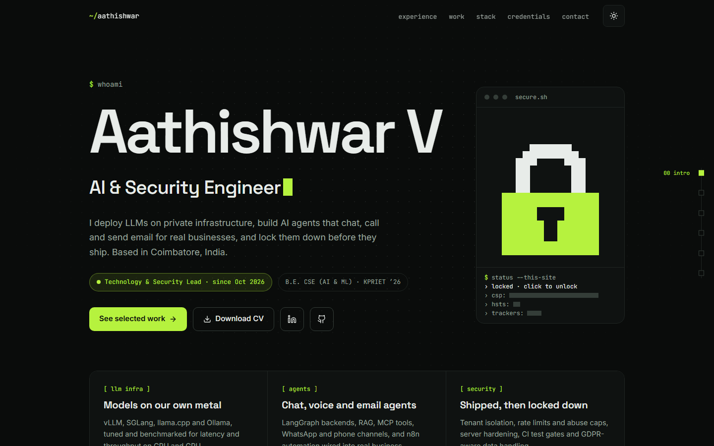
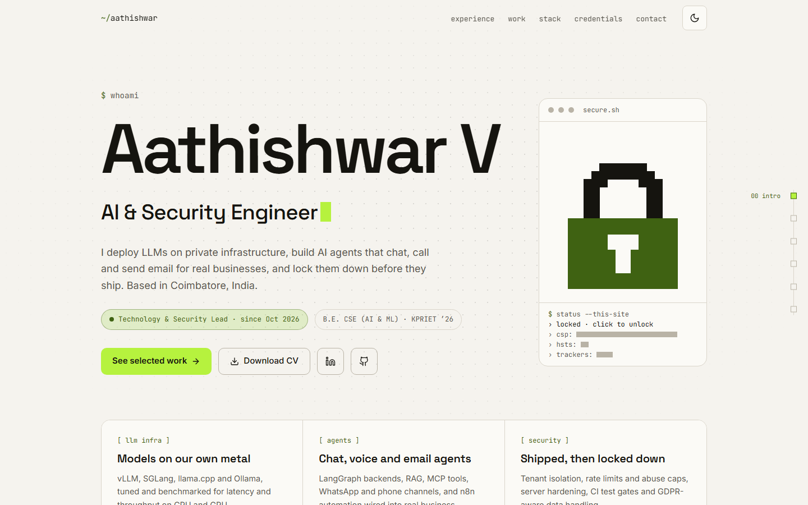

<div align="center">


# Aathishwar V

**AI & Security Engineer. I deploy LLMs, build AI agents that chat, call and send email,
and lock them down before they ship.**

This repository is my portfolio site: one page, a dark and a light theme, and everything
it says kept in a single typed file.


### [Open the site →](https://aathi.online)

</div>

---

## What's on it

- 🧭 **Who I am, in one screen.** Name, role, what I work on now, and three cards for the
  areas I spend my time in: LLM infrastructure, AI agents, and security.
- 💼 **Experience.** Five roles since 2024, each with what I actually did and the tools I
  used to do it.
- 🛠️ **Selected work.** Six projects you can filter by *AI & agents*, *automation* or
  *web & mobile*, with links to the ones that are live. Older projects sit in an archive list.
- 🧱 **Stack.** Grouped by the job each tool does: AI & LLMs, security, backend,
  databases, DevOps & CI/CD, web & mobile.
- 🎓 **Credentials.** Certifications from Cisco, Hack The Box, Anthropic and GitHub, my
  degree, and hackathons.
- ✉️ **Contact.** Email with a copy button, LinkedIn, GitHub, and a form that reaches me
  and sends you a confirmation.

## Things to try

- 🔐 **Click the padlock.** It unlocks and shows this site's real security settings,
  redacted until you do.
- 🌗 **Switch the theme.** Dark is a terminal, light is warm paper. The new theme wipes in
  from the button you pressed.
- 🧩 **Scroll.** Headings decrypt, text loses its redaction bar, and cards dissolve in
  pixel by pixel. A rail on the right shows where you are.
- ✨ **Click anywhere.** Small square sparks, drawn on one canvas that sleeps when nothing
  is moving.

---

## Screenshots

| Dark | Light |
|:---:|:---:|
|  |  |

---

## Fast, private and locked down, in plain words

- **No trackers, no analytics, no ads.** Until you send a message, the page loads nothing
  from any other website. The fonts are served from the site itself.
- **Strict security headers.** A Content-Security-Policy that allows no inline scripts,
  HSTS, no framing by other sites, and no access to camera, microphone or location. They
  live in [`frontend/public/_headers`](frontend/public/_headers).
- **The contact form only talks to anyone when you press Send.** The email library isn't
  even downloaded before then, and a hidden field turns away bots.
- **My phone number isn't on the page.** WhatsApp is a button that builds its link only
  when you press it, so there's no number to scrape or to see on hover.
- **Light on purpose.** About 85 KB of JavaScript gzipped and two preloaded fonts. Every
  animation switches off for people who turn motion off in their system settings.

---

## How it works

```
 frontend/src/data/profile.ts ──► React components ──► Vite build ──► frontend/dist
 frontend/site.config.ts ───────► canonical + Open Graph tags, robots.txt, sitemap.xml
                                                                         │
 git push main ──► GitHub ──► Cloudflare Pages builds and deploys ───────┴──► aathi.online
```

- **One file of content.** Every role, project, skill and certificate lives in
  [`frontend/src/data/profile.ts`](frontend/src/data/profile.ts). The components only
  lay it out; none of the text is written into them.
- **One setting for the domain.** [`frontend/site.config.ts`](frontend/site.config.ts)
  holds the public URL. The build puts it into the meta tags and generates `robots.txt`
  and `sitemap.xml` from it, so moving to a new domain is a one-line change.
- **One observer for every animation.** A single `IntersectionObserver` reveals each
  element once and then forgets it. Animations move with transforms and opacity, so
  scrolling stays smooth.
- **The theme is set before the first paint.** A tiny script in `<head>` applies the saved
  theme, so a reload never flashes the wrong one.

### Built with

| | |
|---|---|
| **UI** | React 19 and TypeScript in strict mode |
| **Styling** | Tailwind CSS 4, with CSS-variable design tokens for both themes |
| **Build** | Vite, plus two small plugins: site-URL injection and font preloading |
| **Fonts** | Space Grotesk, Inter and JetBrains Mono, self-hosted through Fontsource |
| **Animation** | Hand-written: CSS keyframes, one canvas and `requestAnimationFrame`. No animation library |
| **Contact form** | EmailJS, loaded on the first send |
| **Hosting** | Cloudflare Pages, deployed from `main` |

---

## Run it yourself

```
cd frontend
npm install
npm run dev                      # http://localhost:5173
npm run build                    # type check, then a production build in frontend/dist
npm run lint
```

To make it your own, change [`profile.ts`](frontend/src/data/profile.ts) for the content
and [`site.config.ts`](frontend/site.config.ts) for the domain. The EmailJS service and
template IDs sit at the top of
[`Contact.tsx`](frontend/src/components/Contact.tsx); set your site's address as an
allowed origin in the EmailJS dashboard.

---

## Deploy to Cloudflare Pages

In the Cloudflare dashboard, **Workers & Pages → Create → Pages → Import an existing Git
repository**, pick this repository, and use:

| Setting | Value |
|---|---|
| Production branch | `main` |
| Root directory | `frontend` |
| Build command | `npm run build` |
| Build output directory | `dist` |
| Environment variable | `NODE_VERSION` = `22` |

Every push to `main` deploys. `_headers` adds the security and cache headers, and
`404.html` gives unknown paths a real 404. If a push ever doesn't appear in the project's
**Deployments** list, an empty commit (`git commit --allow-empty`) sets it off again.

---

## Project layout

```
frontend/
  src/data/profile.ts     everything the site says
  src/data/sections.ts    section ids and labels, shared by the nav and the scroll rail
  src/components/         one file per section, plus Reveal, DecryptText, PixelLock, ClickSparks
  src/lib/reveal.ts       the shared IntersectionObserver
  src/index.css           design tokens for both themes, and the reveal animations
  site.config.ts          the public URL
  vite.config.ts          the site-URL and font-preload plugins
  public/_headers         CSP, security and cache headers for Cloudflare Pages
  public/theme.js         applies the saved theme before the first paint
  public/404.html         the not-found page
docs/
  screenshots/            the images above
  portfolio-v2-plan.md    what this rebuild set out to do, and in what order
```

---

## Contact

[aathishwar885@gmail.com](mailto:aathishwar885@gmail.com) ·
[LinkedIn](https://www.linkedin.com/in/aathishwar-v/) ·
[GitHub](https://github.com/Aathishwar) · or the form on [the site](https://aathi.online).
